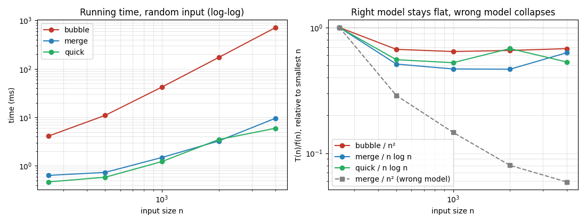
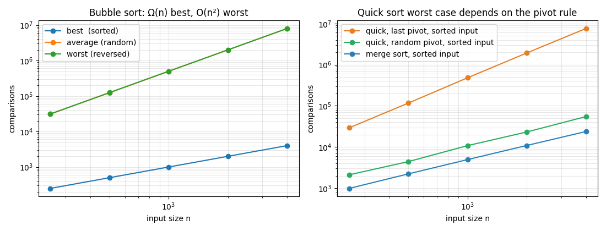
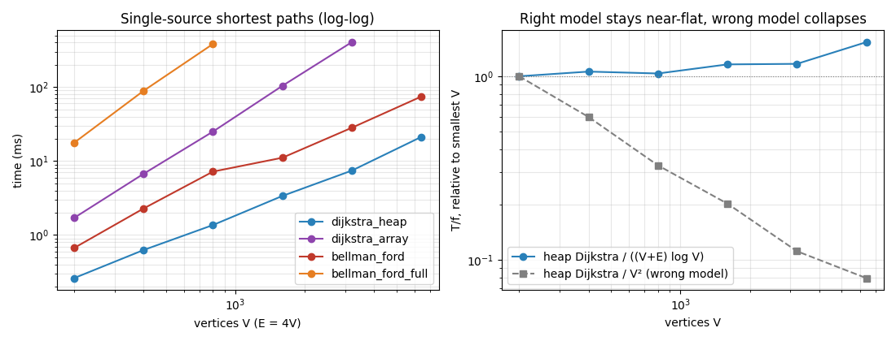
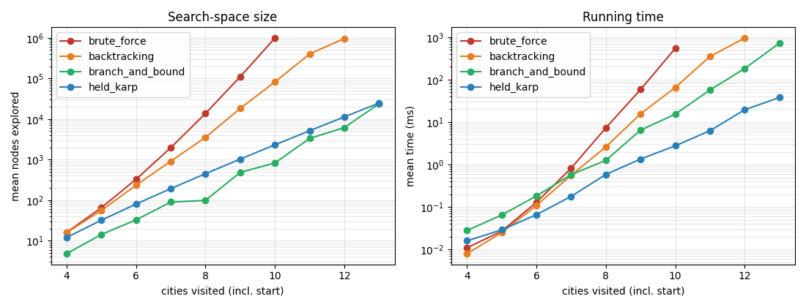

# 1. Abstract

The Smart Traffic Route Optimizer is a route-planning system for a road network of 11 cities and 19 roads in
the Punjab / Chandigarh region. It answers three questions: *what is the best route between two cities*, *how
do all the alternative routes compare*, and *in which order should a vehicle visit several cities and return*.

The project applies the three units of the DAA syllabus to one problem. **Unit 1** (sorting and asymptotic
analysis) ranks the alternative routes with Bubble, Merge and Quick sort and verifies their growth rates
empirically. **Unit 2** (backtracking) enumerates every simple route and solves multi-stop planning with a
pruned state-space tree. **Unit 3** (Dijkstra, Branch & Bound, dynamic programming) finds shortest routes and
compares Least-Cost Branch & Bound with the Held-Karp algorithm. Every algorithm is implemented from scratch,
cross-checked against an independent method, and benchmarked; the measured behaviour is compared with the
theoretical complexity.

# 2. Problem statement and objectives

Drivers choose among routes that differ in distance, travel time and fuel use. Heavy congestion on a short road
can make it slower than a longer, freer one. A delivery vehicle that must visit several cities faces a harder
problem: the number of possible visiting orders grows factorially.

**Objectives**

1. Model the road network as a weighted graph and compute the best route under three criteria: distance, time, fuel.
2. List all alternative routes and rank them with sorting algorithms written for this project.
3. Plan multi-stop trips optimally and show how pruning and bounding shrink the search space.
4. Verify the theoretical time complexities experimentally (tables and graphs).
5. Provide a usable GUI and command-line tool and an automated test suite.

# 3. Mapping to the syllabus

| Syllabus item | Where it appears in the project | Course outcome |
|---|---|---|
| Exp 1: Bubble, Merge, Quick sort; Big-Oh, Omega, Theta verified empirically | `sorting.py`; ranking of routes; `analysis.py` sorting benchmark (Sections 5.1, 7.1) | CO1, CO2 |
| Exp 2/3: recurrence relations, Master and substitution methods | Recurrences for Merge sort, Quick sort and the brute-force state-space tree (Sections 5.1, 5.4) | CO1, CO2 |
| Exp 4: Backtracking, state-space tree, bounding function, nodes explored vs brute force | Route enumeration and the pruned multi-stop search (Sections 5.3, 5.4, 7.3) | CO3 |
| Exp 5: Dijkstra from a source vertex | `shortest_path.py`; best route finder (Sections 5.2, 7.2) | CO3 |
| Exp 6: Least-Cost Branch & Bound with a priority queue; comparison with Held-Karp DP | `multistop.py` (Sections 5.4, 7.3) | CO4 |
| Project: application of Units I-III, performance analysis, scalability | Whole system, `analysis.py`, Section 7 | CO3, CO4, CO5 |

# 4. Data and cost model

The network (`data/roads.csv`) has 11 cities: Ludhiana, Khanna, Mandi Gobindgarh, Sirhind, Rajpura, Patiala,
Ambala, Ropar, Mohali, Zirakpur and Chandigarh, joined by 19 undirected roads. Each road has a length
`d` (km), an average speed `v` (km/h) and a congestion factor `c >= 1`.

* travel time = `d / v * 60 * c` minutes
* fuel = `d * 0.07 * c` litres (stop-and-go traffic burns more fuel)

The values are approximate and illustrative, chosen to make the routing problem realistic; they are not survey
data. Because `v` and `c` vary from road to road, the three criteria can disagree. For example, from Ropar to
Ambala the shortest route is Ropar - Mohali - Zirakpur - Ambala (95 km, 126.6 min), but the fastest is
Ropar - Mohali - Chandigarh - Ambala (100 km, 123.2 min). This is why optimising only distance is not enough.

The file is validated when loaded: distances and speeds must be positive (Dijkstra needs non-negative weights),
congestion must be at least 1, and duplicate roads, self-loops and missing columns are rejected with a clear error.

# 5. Algorithms and analysis

## 5.1 Unit 1 - Sorting and asymptotic analysis

Routes are ranked by the chosen criterion using three sorting algorithms implemented in `sorting.py`. Each returns
the sorted list and the number of key comparisons, so both operation counts and wall-clock time can be measured.

**Bubble sort** repeatedly swaps adjacent out-of-order elements and stops when a pass makes no swap.

* Best case (already sorted): one pass, `n - 1` comparisons, so `Omega(n)`.
* Worst case (reversed): `(n-1) + (n-2) + ... + 1 = n(n-1)/2` comparisons, so `O(n^2)`; average case is also `Theta(n^2)`.

**Merge sort** splits the list in half, sorts each half and merges. The recurrence is

```
T(n) = 2 T(n/2) + Theta(n),   T(1) = Theta(1)
```

With `a = 2`, `b = 2`, `f(n) = Theta(n) = Theta(n^(log_b a))`, case 2 of the Master theorem gives
`T(n) = Theta(n log n)` in the best, average and worst case.

**Quick sort** partitions around a pivot (Lomuto scheme). With a balanced split the recurrence equals Merge
sort's, giving `Theta(n log n)` on average. If the pivot is always the smallest or largest element (last-element
pivot on sorted input), `T(n) = T(n-1) + Theta(n)`, which unrolls to `Theta(n^2)`. The implementation offers both
`pivot="last"` (textbook) and `pivot="random"` (default), and uses an explicit stack that always processes the
smaller part first, so the recursion limit is never reached.

## 5.2 Unit 3 - Dijkstra's shortest-path algorithm

```
DIJKSTRA(G, source):
    dist[v] = infinity for all v;  dist[source] = 0
    push (0, source) into a min-heap
    while heap not empty:
        (d, u) = extract-min
        if u already settled: continue            # stale entry
        mark u settled                            # dist[u] is now final
        for each edge (u, v, w):
            if d + w < dist[v]:                   # relaxation
                dist[v] = d + w;  prev[v] = u
                push (dist[v], v)
```

*Correctness (greedy choice).* When `u` is extracted it has the smallest tentative distance among unsettled
vertices. Any other path to `u` must leave the settled set through some unsettled vertex whose distance is at
least `dist[u]`, and weights are non-negative, so that path cannot be shorter. Hence `dist[u]` is final.

*Complexity.* Each vertex is settled once (`V` extractions, `O(log V)` each) and each edge causes at most one push
(`O(log V)` each, heap size at most `E`): `O((V + E) log V)`. The project also implements the array version,
which finds the minimum by a linear scan (`O(V^2)`), and Bellman-Ford (`O(VE)`), to compare against. For the
user, the search stops as soon as the destination is settled; `prev[]` is followed backwards to rebuild the path.

## 5.3 Unit 2 - Backtracking: all alternative routes

A depth-first search extends a path one city at a time, never revisiting a city already on the path (the
bounding condition that keeps routes simple), and backtracks after reaching the destination. The state-space tree
is exponential in the worst case, but the network is small (Ludhiana to Chandigarh has 103 simple routes), and
the routes it returns are then sorted by the chosen criterion with Merge, Quick or Bubble sort. The test-suite
confirms that the first route in the ranked list has the same cost as the Dijkstra answer, for all three criteria.

## 5.4 Units 2 and 3 - Multi-stop planning (travelling-salesman style)

The vehicle starts at city 0, must visit `n - 1` other cities and return. The cost matrix `D` holds shortest-path
costs between the chosen cities (one Dijkstra run per city). Four solvers return the same optimal tour:

**Brute force.** The full state-space tree: every permutation is tried. Number of nodes
`1 + sum_{k=1}^{n-1} (n-1)!/(n-1-k)!`, which is about `e (n-1)!`.

**Backtracking with a promising function.** Same tree, but a node is expanded only if `cost so far < best
complete tour found`. Subtrees that cannot beat the best tour are cut off (pruned).

**Least-Cost Branch & Bound.** Each node stores a *lower bound* on any tour that extends it:

```
LB = cost_so_far
   + min over unvisited c of D[last][c]                    (the next hop out of the last city)
   + sum over unvisited c of min( min_{d unvisited, d != c} D[c][d] , D[c][0] )
```

Every unvisited city must still be left once, by at least its cheapest outgoing edge, so the bound never
overestimates (it is admissible). A greedy nearest-neighbour tour supplies the initial *upper bound*. Live nodes
sit in a priority queue ordered by lower bound; the node with the smallest bound is expanded first
(least-cost strategy). A node is discarded when `LB >= best known tour`, and the search ends when the smallest
bound in the queue is no better than the best tour.

**Held-Karp dynamic programming.** Let `C(S, j)` be the cheapest path that starts at city 0, visits exactly the
set `S` and ends at `j in S`:

```
C({j}, j) = D[0][j]
C(S, j)   = min over i in S \ {j} of  C(S \ {j}, i) + D[i][j]
answer    = min over j of  C(All, j) + D[j][0]
```

There are `m * 2^(m-1)` reachable states (`m = n - 1`) and `O(m)` work per state: `O(n^2 2^n)` time,
`O(n 2^n)` space. It is exponential, but far smaller than `(n-1)!`.

# 6. System design

| Module | Responsibility |
|---|---|
| `graph.py` | loads and validates the CSV, cost model, route search, ranking, tour planning |
| `shortest_path.py` | Dijkstra (heap, array), Bellman-Ford, path reconstruction |
| `sorting.py` | Bubble, Merge, Quick sort with comparison counters and key functions |
| `multistop.py` | brute force, backtracking, branch & bound, Held-Karp |
| `app.py`, `visualizer.py` | Tkinter GUI with map drawing (Route Finder, Multi-Stop Planner, Performance Analysis tabs) |
| `cli.py` | the same features on the command line |
| `analysis.py` | benchmarks that write the tables and charts in `results/` |
| `tests.py` | 25 automated tests |

**Verification.** The tests cross-check each algorithm against an independent one:

* all three sorts against Python's `sorted` on 36 inputs, including empty, single, duplicate, sorted and reversed lists, and stability of key sorts;
* Dijkstra against Floyd-Warshall for every pair of cities and all three criteria, and the three shortest-path algorithms against each other on random graphs;
* all four multi-stop solvers against each other on random symmetric and asymmetric matrices, checking that each reported cost equals the cost of the returned tour;
* exact comparison counts (bubble sort `n - 1` and `n(n-1)/2`; quick sort with last pivot `n(n-1)/2`) and the brute-force node-count formula;
* data validation, unknown cities, unreachable cities, and running from a different working directory.

# 7. Results and performance analysis

All numbers come from `python analysis.py` (single machine, Python 3, pure-Python implementations). Absolute times
depend on the computer; the *shape* of the curves is what matters. The raw data are in `results/*.csv` and
`results/summary.md`.

## 7.1 Sorting (Experiment 1)

Random integer inputs, median of 3 runs:

| n | bubble (ms) | merge (ms) | quick (ms) |
|---|---|---|---|
| 250 | 2.1 | 0.3 | 0.3 |
| 500 | 8.4 | 0.6 | 0.5 |
| 1000 | 40.0 | 1.4 | 1.0 |
| 2000 | 152.6 | 2.9 | 2.8 |
| 4000 | 660.0 | 6.4 | 5.7 |



Fitting a straight line to log(time) against log(n) gives the measured growth exponent: **2.08** for bubble sort
(theory: 2), and **1.12** for both merge and quick sort (theory: `n log n`, which behaves like an exponent just
above 1 over this range). In the right-hand chart each curve is divided by its theoretical function. The three
correct models stay near 1, while dividing merge sort's time by `n^2` (grey dashed line) falls to 0.087 of its
starting value (a factor of about 11), so only `n log n` fits.

Best, average and worst cases, counted in comparisons for `n = 4000`:

| algorithm | input | comparisons | matches theory |
|---|---|---|---|
| bubble | sorted | 3,999 | `n - 1`, i.e. `Omega(n)` |
| bubble | random | 7,991,784 | about `n^2/2`, i.e. `Theta(n^2)` |
| bubble | reversed | 7,998,000 | exactly `n(n-1)/2` |
| quick, last pivot | sorted | 7,568,437 | `Theta(n^2)` worst case |
| quick, random pivot | sorted | 54,747 | `Theta(n log n)` |
| merge | sorted | 23,728 | below `n log2 n` = 47,863 |



Using the textbook last-element pivot, quick sort degrades to bubble-sort level (7.6 million comparisons) on sorted
input, whereas a random pivot needs only 54,747. The project therefore ships the random pivot as the default.

## 7.2 Shortest paths (Experiment 5)

Random connected graphs with `E = 4V`, single-source run from vertex 0:

| V | E | heap Dijkstra (ms) | array Dijkstra (ms) | Bellman-Ford, early exit (ms) | Bellman-Ford, V-1 passes (ms) |
|---|---|---|---|---|---|
| 200 | 800 | 0.4 | 1.7 | 0.9 | 22.2 |
| 400 | 1,600 | 1.0 | 6.6 | 3.0 | 82.7 |
| 800 | 3,200 | 1.8 | 19.6 | 4.2 | 310.2 |
| 1,600 | 6,400 | 5.5 | 85.4 | 13.0 | - |
| 3,200 | 12,800 | 9.2 | 299.0 | 28.2 | - |
| 6,400 | 25,600 | 25.6 | - | 71.3 | - |



* **Heap Dijkstra** grows with exponent **1.20**, consistent with `O((V+E) log V)`. At `V = 6400` it needs 25.6 ms.
* **Array Dijkstra** has exponent **1.86** (theory 2): doubling `V` roughly quadruples the time, and it is about 33 times slower than the heap version at `V = 3200`.
* **Bellman-Ford with all `V - 1` passes** has exponent **1.90**. With `E = 4V` its `O(VE)` bound equals `O(V^2)`, which matches. It is the slowest method.
* **Bellman-Ford with early exit** looks competitive here (exponent 1.23). This is expected on random graphs: shortest paths have few edges, so the passes stop changing after about a dozen rounds. Its worst case is still `O(VE)` and, unlike Dijkstra, it carries no guarantee; the early-exit speed is a property of these inputs, not of the algorithm.

The right-hand chart again contrasts the right model with a wrong one. Normalising heap Dijkstra's time by
`(V+E) log V` keeps it between 1.0 and 1.4 times its starting value while `V` grows 32-fold, whereas normalising
by `V^2` falls to 0.07 of its starting value (a factor of about 14).

## 7.3 Multi-stop planning (Experiments 4 and 6)

Mean over 5 random Euclidean instances per size (`n` = cities visited including the start). All four solvers
returned the same optimal cost on every instance (the benchmark asserts this). "Nodes" are search-tree nodes
expanded; for Held-Karp they are DP states computed.

| cities | brute force | backtracking | branch & bound | Held-Karp |
|---|---|---|---|---|
| 4 | 16 | 15 | 4 | 12 |
| 6 | 326 | 233 | 32 | 80 |
| 8 | 13,700 | 3,525 | 98 | 448 |
| 10 | 986,410 | 81,689 | 823 | 2,304 |
| 12 | - | 965,242 | 6,125 | 11,264 |
| 13 | - | - | 23,677 | 24,576 |

Search space saved relative to brute force:

| cities | brute-force nodes | backtracking saves | branch & bound saves |
|---|---|---|---|
| 6 | 326 | 28.5% | 90.0% |
| 8 | 13,700 | 74.3% | 99.3% |
| 10 | 986,410 | 91.7% | 99.9% |



Mean running time (ms):

| cities | brute force | backtracking | branch & bound | Held-Karp |
|---|---|---|---|---|
| 8 | 4.59 | 1.87 | 0.95 | 0.34 |
| 10 | 404.78 | 53.72 | 15.81 | 2.50 |
| 12 | - | 740.62 | 167.24 | 16.84 |
| 13 | - | - | 740.20 | 32.93 |

**Observations**

1. The bounding function works. Backtracking prunes 91.7% of the nodes at `n = 10`; the stronger lower bound of Branch & Bound prunes 99.9%. Brute force grows factorially (a factor of 9 when going from 9 to 10 cities); the other three grow much more slowly.
2. **Fewer nodes does not mean less time.** Branch & Bound expands very few nodes, but each node costs `O(n^2)` to bound and a heap operation. At `n = 13` it explores almost as many nodes as Held-Karp has states (23,677 versus 24,576) and takes about 22 times longer (740 ms versus 33 ms).
3. For the sizes tested, **Held-Karp is the fastest exact method**. Branch & Bound can need much less memory than Held-Karp's `O(n 2^n)` table when pruning is strong, and a tighter bound would shift the time balance in its favour.
4. The same pattern appears on the real road network (start Ludhiana, random stops, `roads.csv`): at 8 stops brute force needs 109,601 nodes, backtracking 15,046, Branch & Bound 160 and Held-Karp 1,024 states.

## 7.4 Worked examples (command-line output)

**Fastest versus shortest.** `python cli.py route Ropar Ambala --by time` returns Ropar - Mohali - Chandigarh -
Ambala (100 km, 123.2 min), while `--by distance` returns Ropar - Mohali - Zirakpur - Ambala (95 km, 126.6 min).

**Ranked alternatives.** `python cli.py route Ludhiana Chandigarh --by time --alternatives 5` finds 103 simple
routes. The best is Ludhiana - Khanna - Sirhind - Mohali - Chandigarh (117 km, 128.3 min, 8.79 L); the fifth best
takes 159.0 min. Ranking the 103 routes took 530 comparisons with Merge sort, 610 with Quick sort and 5,243 with
Bubble sort, a direct illustration of `n log n` versus `n^2`.

**Multi-stop trip.** `python cli.py tour Ludhiana Patiala Ambala Mohali Ropar --compare` gives a 320 km tour
Ludhiana - Ropar - Mohali - Ambala - Patiala - Ludhiana; brute force expands 65 nodes, backtracking 53, Branch &
Bound 5 and Held-Karp 32 states, all with the same optimal cost.

# 8. Limitations and future work

* The road data are approximate and static. A real deployment would read live traffic feeds and use time-of-day congestion.
* All four multi-stop solvers are exact and therefore exponential. For tens of cities a heuristic (nearest neighbour with 2-opt improvement) or a stronger bound (1-tree / minimum-spanning-tree bound) would be needed.
* The network is small enough to enumerate all simple routes; on a city-scale graph this should be replaced by a k-shortest-paths algorithm (Yen's algorithm).
* A* search with a straight-line-distance heuristic could speed up single-route queries.
* Timings are from pure Python; a C++ or Java version would lower the constants, though not the growth rates.

# 9. Conclusion

One practical problem, route planning, exercised all three units of the syllabus. The sorting study confirmed
`Omega(n)`/`Theta(n^2)` for Bubble sort, `Theta(n log n)` for Merge sort and the pivot-dependent worst case of Quick
sort. Dijkstra with a heap scaled as `O((V+E) log V)` and beat the array and Bellman-Ford versions as the graph
grew. For multi-stop trips, a bounding function reduced the search space by up to 99.9%, and the comparison with
Held-Karp showed that the algorithm with the fewest nodes is not automatically the fastest. All algorithms are
tested against independent implementations, and the measured results agree with the theoretical analysis.

# 10. References

1. T. H. Cormen, C. E. Leiserson, R. L. Rivest, C. Stein, *Introduction to Algorithms*, MIT Press.
2. A. Levitin, *Introduction to the Design and Analysis of Algorithms*, Pearson.
3. E. W. Dijkstra, "A note on two problems in connexion with graphs", *Numerische Mathematik* 1, 1959.
4. M. Held, R. M. Karp, "A dynamic programming approach to sequencing problems", *J. SIAM* 10, 1962.
5. J. D. C. Little, K. G. Murty, D. W. Sweeney, C. Karel, "An algorithm for the traveling salesman problem", *Operations Research* 11, 1963.
